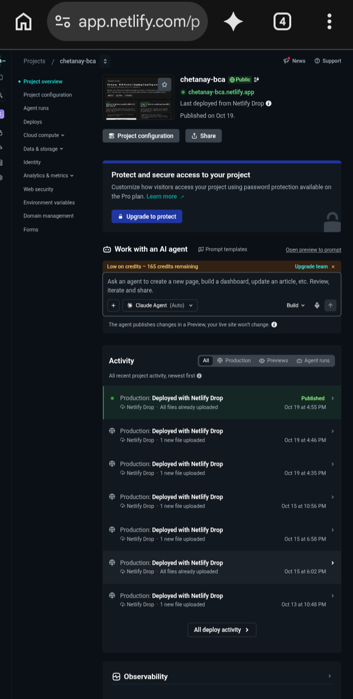

# Chetanay - BCA Cloud Portfolio
**Live:** https://chetanay-bca.netlify.app
**Student:** BCA First Year | Aspiring AWS Cloud Engineer | Delhi
**Email:** Princevinayak22@gmail.com
 
### 📸 LIVE PROOF - Deployed Project
Real deployment on Netlify (Same as AWS S3 + CloudFront)



Project: chetanay-bca | Status: Published ✅ | 7 Deployments

---
## Overview
This portfolio demonstrates 3 core AWS Cloud Hosting Concepts using free tools (GitHub + Netlify + Linux).

### Project 1: AWS S3 Static Website + CloudFront Concept [LIVE ✓]
- **Concept:** How AWS S3 hosts static websites and CloudFront gives global CDN.
- **Implementation:** Hosted static portfolio on Netlify.
- **CI/CD Concept:** Same as AWS CodePipeline. Push to GitHub main branch -> Auto Deploy to Netlify -> Live.
- **Live Link:** https://chetanay-bca.netlify.app
- **Tech:** HTML, CSS, GitHub, Netlify CI/CD

### Project 2: AWS EC2 Linux Server Concept [DEMO RECORDED]
- **Concept:** How AWS EC2 launches a Linux Ubuntu instance and runs a web server on port 8000.
- **Implementation:** Used GitHub Codespace (Ubuntu Linux VM - same as EC2 Instance).
- **Commands Executed:**
  ```bash
  python3 -m http.server 8000
  # Server running on http://localhost:8000
  # Public URL: https://*.app.github.dev:8000


### Project 3: Docker + Nginx Containerization [LIVE ✅]
- **Concept:** How to containerize web apps with Docker (industry standard for Cloud/DevOps). Same as AWS ECS/Fargate concept.
- **Implementation:** Created Dockerfile with nginx:alpine, built image, ran container on port 8000.
- **Commands Executed:**
```bash
docker build -t chetanay-portfolio .
docker run -d -p 8000:80 chetanay-portfolio
# Live on: https://*.app.github.dev:8000 (Docker container)
```

### Project 4: Linux Health Check - SRE / CloudWatch Concept [LIVE ✅]
- **Concept:** How AWS CloudWatch monitors EC2 servers
- **Implementation:** Bash script checking uptime, disk, memory, CPU - built on phone
- **Commands:** chmod +x health-check.sh && ./health-check.sh
- **Tech:** Linux, Bash, SRE
